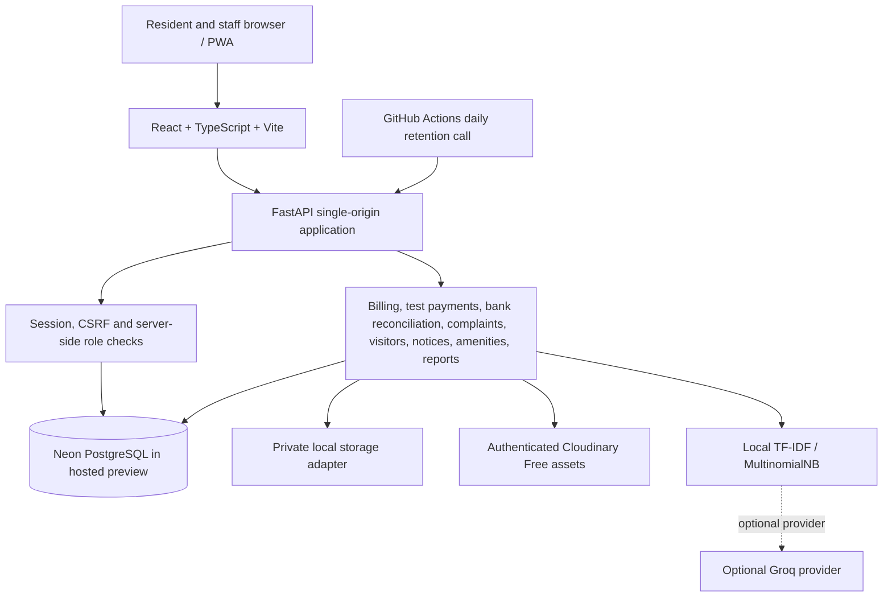

# Township One — Architecture

## Product context

Township One is a resident and facilities application based on Brief 2 of the supplied challenge. The reference dataset represents 2,400 apartments in 28 towers, 180 on-site staff and four gates in Pune. All names, visitor records, payment rows and other demo records are synthetic.

The implementation brings resident maintenance, test payments, complaint tracking, visitor approval, notices and amenity booking into one mobile-first web application. Staff workspaces support CSV reconciliation, complaint triage, gate operations and committee reporting.

## Application components

| Area | Current implementation | Boundary |
|---|---|---|
| User interface | React, TypeScript, Vite and PWA shell; hosted static build served by FastAPI | Same-origin deployment avoids a separate frontend service and CORS configuration. |
| API | FastAPI with Pydantic validation | Session cookie, CSRF protection and server-side resource authorization. |
| Data | SQLAlchemy 2.0 and Alembic | PostgreSQL is the shared deployment database; SQLite is used for portable tests. |
| Money | Python `Decimal`, database numeric columns and transactional rechecks | PostgreSQL row-lock/concurrency guarantees still require PostgreSQL execution. |
| Photos | Local private storage or Cloudinary Free authenticated assets | No public asset URLs; reads pass through signed application routes. |
| Complaint AI | Local TF-IDF / MultinomialNB, optional Groq adapter | Synthetic training examples; not production-accuracy validated. AI never posts money or overrides emergency phrase rules. |
| Retention | Token-protected endpoint plus scheduled GitHub Actions workflow | Enable workflow and configure secrets after deployment; monitor execution. |

## Free hosted preview profile

- **Render Free Docker service:** serves frontend and FastAPI together. Expect sleep/cold starts; the local container filesystem is not durable.
- **Neon Free PostgreSQL:** shared database, with account-level compute, storage and egress limits. Use the pooled connection string and TLS.
- **Cloudinary Free image storage:** authenticated image storage under the current free credit allowance. Keep assets authenticated; monitor monthly credits.
- **GitHub Actions:** scheduled daily retention call for a public repository.
- **AI:** local scikit-learn classifier works without any external model key. Groq is optional and should remain disabled unless the account has a current free quota.

This profile is for a challenge/reviewer demonstration. It is not a production SLA or a guarantee that usage can never exceed a provider's free quota.

## Data and transaction principles

### Monetary calculations

Currency calculations use `Decimal`; persisted monetary columns use database numeric types. JSON money values are represented as decimal strings. The demo maintenance principal uses the supplied rate of ₹6.50 per square foot per month. Due date, grace period and late interest settings remain illustrative until the federation approves the actual bye-law configuration.

### Resident flat ledger

The flat ledger records bill debits, payment credits and adjustment/reversal entries for each flat. It is a resident balance history, not a replacement for the federation's accounting system or Tally. Corrections should use compensating entries rather than editing posted financial history.

### Payment idempotency and reconciliation

Test checkout uses an idempotency key and request fingerprint to prevent duplicate logical payment operations. Bank matching uses deterministic evidence. Unclear or conflicting rows are held for Accounts review; AI does not authorize financial postings. PostgreSQL row locks are part of the intended concurrency path but have not been demonstrated by the SQLite-only run recorded in this checkout.

### Authorization

The backend resolves active roles and flat memberships from server-side records. Guard operations also check the guard's assigned gate and enrolled device/generation. A client-supplied flat ID, gate ID or role is not an authorization decision. Committee reporting is designed around aggregate data; resident-level access remains subject to resource permissions.

## Environment and deployment notes

- The Docker image builds the frontend with Node 24.15 and runs the API with Python 3.11.
- The container applies forward Alembic migrations and can run the idempotent demo seeder only through explicit `APP_ENV=demo`, `ALLOW_REMOTE_DEMO_SEED=true` and `--allow-remote-demo-seed` opt-ins. Remote destructive resets are rejected.
- Hosted images are stored in private Cloudinary Free; local files are not relied on after a Render restart.
- The retention API requires a separate high-entropy job token. The workflow is configured in source but requires Render and GitHub secret setup by the repository owner.
- SMS/OTP delivery is simulated in demo; no real SMS provider is connected. Test payments are simulated; no funds are collected.
