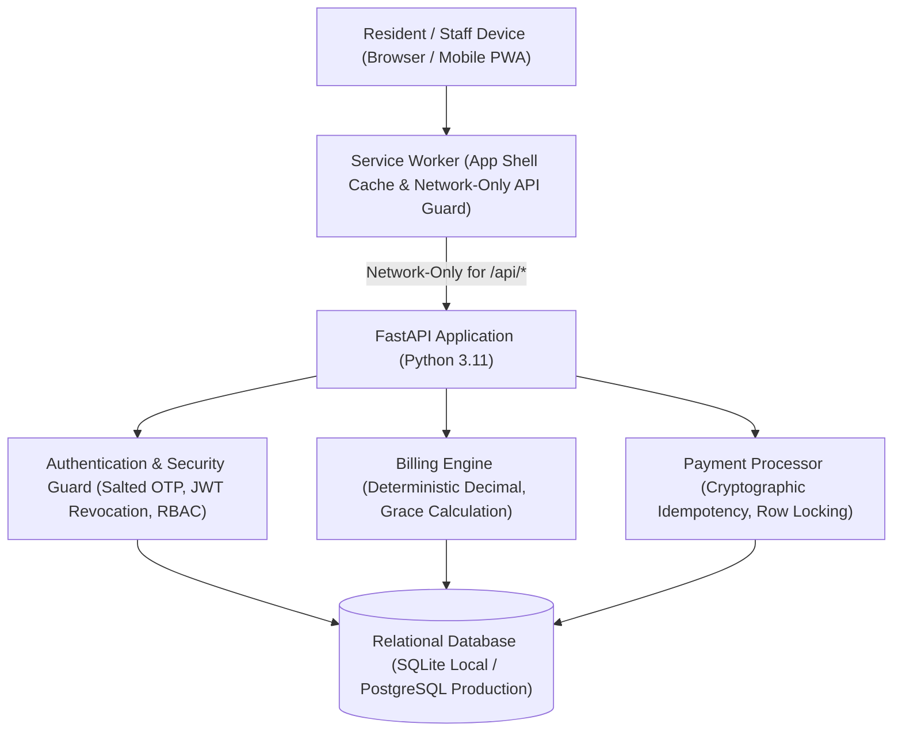

# Township One — System Architecture

## 1. Executive Summary

Township One is an enterprise-grade gated community operations and resident management platform engineered for large-scale residential townships. The system is specifically architected for **Company A, Pune**, accommodating **2,400 residential flats across 28 towers, 180 on-site operations staff, and 4 multi-lane security gates**.

The platform is designed around reliability, data integrity, auditability, and role-based access control.

---

## 2. Technology Stack

| Layer | Component | Technology | Rationale |
|---|---|---|---|
| **Frontend** | Single Page Application / PWA | React 19, TypeScript, Vite 6 | Type safety, reactive UI state machine, sub-second asset compilation. |
| **Offline Cache** | Service Worker | Vanilla JavaScript (Cache API) | App shell caching, dynamic asset cache, strict network-only bypass for private financial API calls. |
| **Backend** | REST API Services | FastAPI, Python 3.11, Pydantic v2 | High-performance asynchronous ASGI framework with automated OpenAPI contract generation and strict typing. |
| **ORM & Migrations** | Data Access Layer | SQLAlchemy 2.0, Alembic | Declarative data models, deterministic schema migrations, dialect-agnostic SQL generation (SQLite & PostgreSQL). |
| **Precision Math** | Financial Computing | Python `decimal.Decimal` (ROUND_HALF_UP) | Complete elimination of IEEE 754 binary floating-point rounding errors in currency arithmetic. |
| **Security** | Auth & Encryption | PyJWT, Passlib, hashlib, HMAC | Salted SHA-256 OTP hashes, constant-time verification, persistent token revocation via unique JTI tracking. |

---

## 3. Core Architectural Principles

### 3.1 Strict Financial Precision
Financial balances and currency transactions are never represented as floating-point numbers. All internal arithmetic utilizes Python's authoritative `Decimal` type with explicit two-decimal rounding (`ROUND_HALF_UP`). API schemas provide both decimal fields and pre-formatted INR strings (e.g., `"7475.00"`), guaranteeing zero drift between client formatting and ledger entries.

### 3.2 Dual-Entry Flat Ledger Bookkeeping
Every financial event produces a permanent audit record in the `flat_ledger_entries` table:
- **Bill Issuance:** Posts an authoritative `DEBIT` entry, increasing the flat's outstanding balance.
- **Payment Settlement:** Posts an atomic `CREDIT` entry, decreasing the flat's outstanding balance.
Running balances are calculated and stamped at transaction time (`balance_after`), enabling real-time ledger statement reconstruction and reconciliation.

### 3.3 Cryptographic Payment Idempotency
To prevent accidental duplicate payments caused by network retries or double clicks:
1. Every payment checkout requires a mandatory client-supplied `idempotency_key` (minimum 8 characters).
2. The server binds the key to a cryptographic SHA-256 request fingerprint combining:
   $$\text{SHA256}(\text{user\_id} : \text{flat\_id} : \text{bill\_id} : \text{amount} : \text{currency} : \text{method} : \text{outcome})$$
3. Concurrent requests are serialized using database row-level locking (`with_for_update`).
4. Replaying the identical key with matching parameters returns the existing transaction without creating duplicate payments or receipts.
5. Reusing a key across different residents returns a generic HTTP 409 conflict, completely preventing data leakage or payment snooping across flats.

### 3.4 Multi-Tier Role-Based Access Control (RBAC)
Server-side authorization is enforced at every endpoint:
- **Residents (Owners/Tenants):** Access restricted strictly to their assigned flat(s). Tenants possess active bill payment permissions.
- **Family Members:** Assigned read permissions for billing summaries and visitor approvals, but blocked from executing bill payments.
- **Management Committee:** Granted access to anonymized aggregate township financial reports; strictly forbidden from drilling down into individual resident flats (HTTP 403).
- **Security Guards:** Access restricted to gate entry/exit logs; financial and billing records are completely inaccessible (HTTP 403).

---

## 4. Environment & Database Decoupling

The platform guarantees strict isolation between environments:
- **Local Development / Reviewer Demo:** Zero-dependency SQLite database (`township_one.db`) pre-seeded with 2,400 flats and exact sample scenarios.
- **Automated Test Suite:** Fully decoupled test database (`township_one_test.db`) initialized and isolated per test module to ensure tests never mutate demo data.
- **Production:** PostgreSQL 15+ via psycopg driver, enforced with startup configuration guards that reject weak secrets, debug flags, or simulated payment modes.
