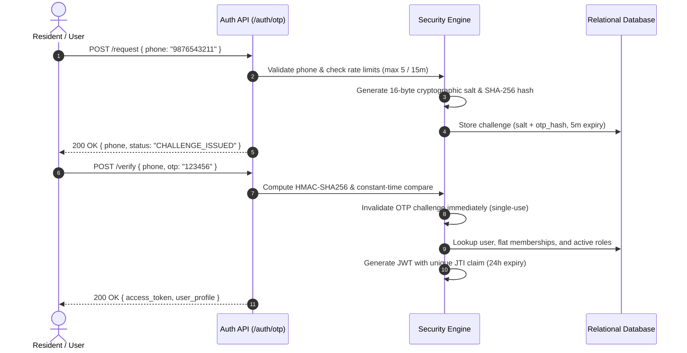

# Township One — Authentication & Access Control

## 1. Authentication Lifecycle

Township One implements a passwordless, mobile-first One-Time Password (OTP) authentication flow backed by JSON Web Tokens (JWT).

---

## 2. Cryptographic Security Standards

### 2.1 Salted Hash OTP Storage
Raw OTPs are never stored in memory or database state in plaintext:
1. When an OTP is requested, the server creates a unique 16-byte random salt:
   $$\text{salt} = \text{secrets.token\_hex}(16)$$
2. The OTP is hashed using SHA-256 with the salt:
   $$\text{otp\_hash} = \text{hashlib.sha256}((\text{salt} + \text{otp}).\text{encode}()).\text{hexdigest}()$$
3. Only the `salt` and `otp_hash` are retained in the challenge store.
4. Incoming verification attempts are checked using `hmac.compare_digest` to prevent timing side-channel attacks.

### 2.2 Brute Force & Rate Limit Defenses
- **Request Limiting:** Maximum 5 OTP request challenges per phone number per 15-minute rolling window.
- **Verification Limiting:** Maximum 3 incorrect OTP submission attempts per challenge. Exceeding 3 invalid attempts locks the challenge and requires requesting a new OTP.
- **Single-Use Replay Prevention:** Once verified, an OTP challenge is immediately removed from the active challenge pool. Attempting to replay an already-consumed OTP results in HTTP 400 Bad Request.

### 2.3 JWT Lifecycle Management & Persistent Revocation
- JWT payloads carry a unique `jti` (JWT ID) UUID claim alongside `sub` (user ID), `phone`, and `exp`.
- When a user logs out (`POST /api/v1/auth/logout`), the token's `jti` is permanently persisted in the `revoked_tokens` database table and cached in memory.
- Every authenticated request verifies that the token's `jti` has not been revoked.

---

## 3. Role-Based Access Control Permissions Framework

Server-side authorization is verified using dependency injection guards (`verify_flat_access`, `require_role`):

| Role Code | Scope | Flat Financials | Aggregate Reports | Visitor Management | Maintenance Complaints |
|---|---|---|---|---|---|
| `OWNER` | Assigned Flat(s) | Read + Pay | Denied (403) | Approve Passes | Lodge Tickets |
| `TENANT` | Assigned Flat(s) | Read + Pay | Denied (403) | Approve Passes | Lodge Tickets |
| `FAMILY` | Assigned Flat(s) | Read Only (Pay Denied) | Denied (403) | Approve Passes | Lodge Tickets |
| `COMMITTEE` | Entire Township | **Strictly Denied (403)** | **Authorized Read** | View Incident Metrics | View Analytics |
| `GUARD` | Gates 1–4 | **Strictly Denied (403)** | Denied (403) | Check-in / Check-out | Emergency Reports |
| `ADMIN` | System Wide | Authorized | Authorized | Full Access | Full Access |

### Critical Security Boundaries
- **IDOR Protection:** Residents cannot view, query, or pay bills belonging to other flats. Attempting to query another resident's flat summary or receipt yields HTTP 403 Forbidden.
- **Committee Privacy Guard:** Committee members cannot inspect individual flat resident ledger records or outstanding balances. They are restricted strictly to `/api/v1/billing/committee/aggregate`.
- **Family Member Payment Restriction:** Family members (`member_type = "FAMILY"`) cannot trigger checkout payments (`can_pay_bills = False`), preventing unauthorized child or non-paying family charges.
