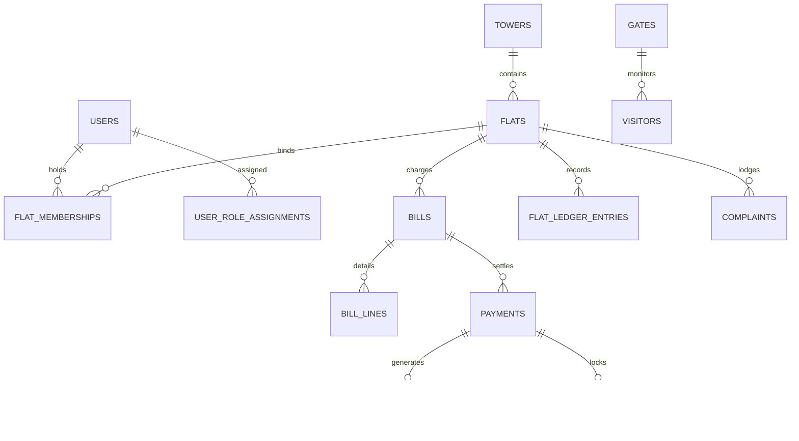

# Township One — Data Model & Schema Specification

## 1. Entity-Relationship Overview

The database schema models the spatial hierarchy, residency memberships, role permissions, and financial ledgers of the gated township.

---

## 2. Core Tables & DDL Definitions

### 2.1 Spatial Hierarchy (`towers` & `flats`)

#### `towers`
Stores physical residential high-rise towers.
| Column | Type | Constraints | Description |
|---|---|---|---|
| `id` | VARCHAR(36) | PRIMARY KEY | UUID identifier |
| `code` | VARCHAR(10) | UNIQUE, NOT NULL | Tower code (e.g., `T01` to `T28`) |
| `name` | VARCHAR(50) | NOT NULL | Display name (e.g., `Tower 01`) |
| `total_floors` | INTEGER | NOT NULL | Floor count (e.g., 20 or 25) |
| `flats_per_floor` | INTEGER | NOT NULL | Flat count per floor (e.g., 4) |

#### `flats`
Stores individual residential apartment units.
| Column | Type | Constraints | Description |
|---|---|---|---|
| `id` | VARCHAR(36) | PRIMARY KEY | UUID identifier |
| `tower_id` | VARCHAR(36) | FOREIGN KEY (`towers.id`), NOT NULL | Owning tower |
| `flat_number` | VARCHAR(20) | UNIQUE, NOT NULL | Flat designation (e.g., `T07-1203`, `T12-0408`) |
| `floor_number` | INTEGER | NOT NULL | Floor index |
| `area_sqft` | NUMERIC(10,2) | NOT NULL | RERA carpet/chargeable area in sq ft |
| `bhk_type` | VARCHAR(10) | NULL | Configuration (e.g., `1BHK`, `2BHK`, `3BHK`) |

---

### 2.2 Identity & Role Scoping (`users`, `flat_memberships`, `user_role_assignments`)

#### `users`
Authenticated principals (residents, committee members, operations staff).
| Column | Type | Constraints | Description |
|---|---|---|---|
| `id` | VARCHAR(36) | PRIMARY KEY | UUID identifier |
| `phone` | VARCHAR(20) | UNIQUE, NOT NULL | 10-digit mobile number |
| `name` | VARCHAR(100) | NOT NULL | Legal full name |
| `email` | VARCHAR(100) | NULL | Contact email |
| `is_active` | BOOLEAN | DEFAULT TRUE | Active account flag |
| `created_at` | DATETIME | NOT NULL | Account creation timestamp |

#### `flat_memberships`
Binds users to specific residential flats with fine-grained permissions.
| Column | Type | Constraints | Description |
|---|---|---|---|
| `id` | VARCHAR(36) | PRIMARY KEY | UUID identifier |
| `flat_id` | VARCHAR(36) | FOREIGN KEY (`flats.id`), NOT NULL | Associated flat |
| `user_id` | VARCHAR(36) | FOREIGN KEY (`users.id`), NOT NULL | Associated user |
| `member_type` | VARCHAR(20) | NOT NULL | `OWNER`, `TENANT`, `FAMILY`, `PRIMARY_RESIDENT` |
| `is_active` | BOOLEAN | DEFAULT TRUE | Active membership status |
| `can_pay_bills` | BOOLEAN | DEFAULT FALSE | Permission to execute bill payments |
| `can_approve_visitors`| BOOLEAN | DEFAULT TRUE | Permission to approve entry passes |
| `can_raise_complaints`| BOOLEAN | DEFAULT TRUE | Permission to lodge maintenance tickets |

---

### 2.3 Maintenance Billing & Flat Ledger (`billing_rules`, `bills`, `bill_lines`, `flat_ledger_entries`)

#### `billing_rules`
Defines maintenance tariffs and grace period parameters.
| Column | Type | Constraints | Description |
|---|---|---|---|
| `id` | VARCHAR(36) | PRIMARY KEY | Rule identifier |
| `name` | VARCHAR(100) | NOT NULL | Tariff name |
| `rate_per_sqft` | NUMERIC(10,2) | NOT NULL | Maintenance tariff (₹6.50/sq ft) |
| `due_day_of_month` | INTEGER | DEFAULT 15 | Due day (15th of the month) |
| `grace_period_days`| INTEGER | DEFAULT 5 | Grace window (5 days, ending on 20th) |
| `late_fee_percentage_pa`| NUMERIC(5,2) | DEFAULT 18.00 | Illustrative late interest rate per annum |
| `is_active` | BOOLEAN | DEFAULT TRUE | Currently active rule flag |

#### `bills`
Monthly maintenance bills generated per flat.
| Column | Type | Constraints | Description |
|---|---|---|---|
| `id` | VARCHAR(36) | PRIMARY KEY | Bill identifier |
| `flat_id` | VARCHAR(36) | FOREIGN KEY (`flats.id`), NOT NULL | Billed flat |
| `period_month` | INTEGER | NOT NULL | Billing period month (1–12) |
| `period_year` | INTEGER | NOT NULL | Billing period year (e.g., 2026) |
| `issue_date` | DATETIME | NOT NULL | Date bill was generated/issued |
| `due_date` | DATETIME | NOT NULL | Date payment is due |
| `area_sqft` | NUMERIC(10,2) | NOT NULL | Area captured at billing time |
| `rate_per_sqft` | NUMERIC(10,2) | NOT NULL | Tariff captured at billing time |
| `principal_amount`| NUMERIC(14,2) | NOT NULL | `area_sqft * rate_per_sqft` |
| `late_fee_amount` | NUMERIC(14,2) | DEFAULT 0.00 | Assessed late fee |
| `total_amount` | NUMERIC(14,2) | NOT NULL | Net total billed |
| `paid_amount` | NUMERIC(14,2) | DEFAULT 0.00 | Cumulative settled amount |
| `balance_amount` | NUMERIC(14,2) | NOT NULL | `total_amount - paid_amount` |
| `status` | VARCHAR(20) | NOT NULL | `ISSUED`, `PARTIALLY_PAID`, `PAID`, `OVERDUE` |

#### `flat_ledger_entries`
Immutable per-flat maintenance ledger recording debit and credit movements. This is not a full double-entry accounting ledger and does not replace Tally.
| Column | Type | Constraints | Description |
|---|---|---|---|
| `id` | VARCHAR(36) | PRIMARY KEY | Ledger entry UUID |
| `flat_id` | VARCHAR(36) | FOREIGN KEY (`flats.id`), NOT NULL | Associated flat |
| `entry_type` | VARCHAR(20) | NOT NULL | `DEBIT` (invoice) or `CREDIT` (payment) |
| `amount` | NUMERIC(14,2) | NOT NULL | Transaction amount |
| `balance_after` | NUMERIC(14,2) | NOT NULL | Running flat balance immediately after entry |
| `description` | VARCHAR(255) | NOT NULL | Narrative explanation and transaction details |
| `reference_id` | VARCHAR(50) | NULL | Referenced bill ID or payment transaction ID |
| `created_at` | DATETIME | NOT NULL | Transaction timestamp |

---

### 2.4 Payment & Idempotency Locking (`payments`, `payment_idempotency_records`, `receipts`)

#### `payment_idempotency_records`
Serializes concurrent checkout requests and enforces payload integrity.
| Column | Type | Constraints | Description |
|---|---|---|---|
| `id` | VARCHAR(36) | PRIMARY KEY | UUID identifier |
| `idempotency_key` | VARCHAR(100) | UNIQUE, NOT NULL | Client-supplied stable key |
| `user_id` | VARCHAR(36) | FOREIGN KEY (`users.id`), NOT NULL | Authenticated user |
| `flat_id` | VARCHAR(36) | FOREIGN KEY (`flats.id`), NOT NULL | Target flat |
| `bill_id` | VARCHAR(36) | FOREIGN KEY (`bills.id`), NOT NULL | Target bill |
| `amount` | NUMERIC(14,2) | NOT NULL | Exact payment amount |
| `currency` | VARCHAR(10) | NOT NULL | Currency code (`INR`) |
| `request_hash` | VARCHAR(64) | NOT NULL | SHA-256 fingerprint of request parameters |
| `status` | VARCHAR(20) | NOT NULL | `IN_PROGRESS` or `COMPLETED` |
| `payment_id` | VARCHAR(36) | FOREIGN KEY (`payments.id`), NULL | Created payment record |

#### `receipts`
Official tax and financial payment vouchers issued on successful settlement.
| Column | Type | Constraints | Description |
|---|---|---|---|
| `id` | VARCHAR(36) | PRIMARY KEY | Receipt UUID |
| `payment_id` | VARCHAR(36) | FOREIGN KEY (`payments.id`), NOT NULL | Associated payment record |
| `receipt_number` | VARCHAR(50) | UNIQUE, NOT NULL | Standardized voucher format (`REC-YYYYMM-XXXXX`) |
| `flat_number` | VARCHAR(20) | NOT NULL | Denormalized flat number |
| `resident_name` | VARCHAR(100) | NOT NULL | Payer name |
| `amount` | NUMERIC(14,2) | NOT NULL | Exact settled amount |
| `payment_mode` | VARCHAR(30) | NOT NULL | Payment instrument |
| `transaction_reference`| VARCHAR(50) | NOT NULL | Unique gateway reference |
| `issued_at` | DATETIME | NOT NULL | Timestamp voucher was issued |
