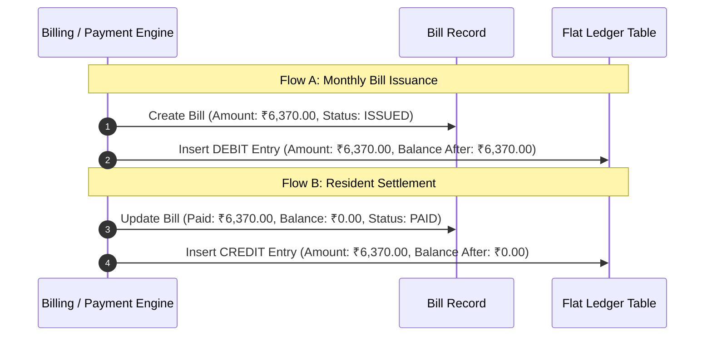

# Township One — Maintenance Billing & Ledger

## 1. Tariff & Principal Maintenance Calculations

Maintenance fees for all residential units are calculated based on RERA carpet/chargeable area:

$$\text{Principal Amount} = \text{Flat Area (sq ft)} \times \text{Rate per sq ft}$$

- **Standard Tariff:** ₹6.50 per sq ft per month.
- **Example Calculations:**
  - 1,150 sq ft flat (T07-1203):
    $$1,150 \times 6.50 = ₹7,475.00$$
  - 980 sq ft flat (T12-0408):
    $$980 \times 6.50 = ₹6,370.00$$
  - 1,640 sq ft flat (T21-1601):
    $$1,640 \times 6.50 = ₹10,660.00$$

All arithmetic is executed in `Decimal` and quantized to 2 decimal places using `ROUND_HALF_UP`.

---

## 2. Grace Period Boundaries & Overdue Rules

Monthly billing cycles follow strict boundary rules:
- **Issue Date:** 1st day of the billing period month.
- **Due Date:** 15th day of the billing period month.
- **Grace Period:** 5 calendar days following the due date (active through the 20th).
- **Grace Expiration:** On the 21st day, the grace period expires. Overdue days and interest are calculated from the original due date (15th).

```
1st of Month              15th (Due Date)         20th (Grace Ends)       21st (Overdue)
    |----------------------------|------------------------|---------------------->
       Bill Issued                Payment Due              Grace Window Active    Interest Accrues
                                  (0 Days Overdue)         (0 Late Fee)           From 15th Due Date
```

---

## 3. Late-Fee Policy & Legal Grounding

> [!IMPORTANT]
> **Legal Grounding Notice:**  
> The late fee calculation (18.00% simple interest per annum) is an **unapproved illustrative demonstration assumption** pending society general body and federation approval. It must never be presented as an established statutory rate under Maharashtra cooperative societies law.

### Configurable Interest Formula
When overdue past the grace cutoff, simple interest is computed as:

$$\text{Interest} = \text{Outstanding Balance} \times \left(\frac{\text{Annual Rate \%}}{100}\right) \times \left(\frac{\text{Overdue Days}}{\text{Days in Year}}\right)$$

- **Leap Year Support:** The engine evaluates whether the reference year is a leap year (`calendar.isleap(as_of.year)`):
  $$\text{Days in Year} = \begin{cases} 366 & \text{if leap year} \\ 365 & \text{otherwise} \end{cases}$$
- **Principal Separation:** In the flat ledger, late fees are tracked as distinct line items and are never commingled into the base principal maintenance balance.

---

## 4. Multi-Bill Aggregation

The resident billing summary endpoint (`/api/v1/billing/flats/{flat_id}/summary`) aggregates all eligible unpaid bills for the flat:
- `unpaid_bills`: List of all bills with positive remaining balances (`balance_amount > 0`).
- `total_outstanding_due`: Sum of all unpaid bill balances.
- `overdue_days`: Maximum overdue duration among active unpaid bills.
- `estimated_late_fee`: Cumulative assessed late fee across all unpaid bills.

---

## 5. Dual-Entry Ledger Flow


