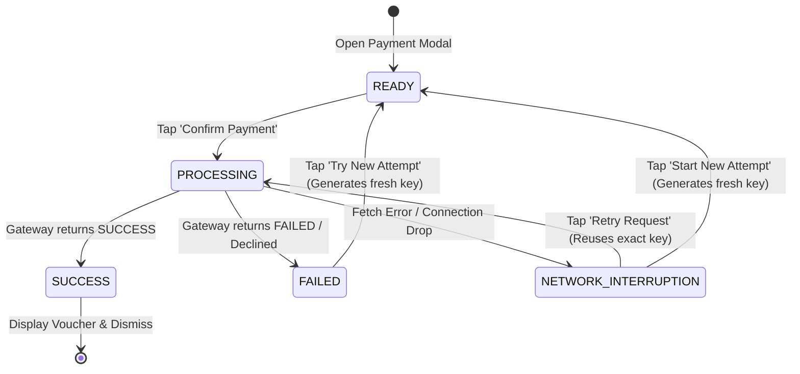

# Township One — Payments & Receipts Architecture

## 1. Simulated Payment Gateway (Test Mode)

The Township One resident portal includes an embedded, sandbox-safe simulated payment gateway designed for developer testing and reviewer demonstrations without charging real bank accounts or UPI handles.

### Strict Outcome Modes
The gateway accepts only explicit, verified test outcome values:
- `SUCCESS`: Immediately settles bill balance, writes dual-entry credit ledger, and issues receipt.
- `PENDING`: Simulates bank settlement delay; leaves outstanding balance intact.
- `FAILED`: Simulates card or UPI decline; leaves outstanding balance intact.
- `EXPIRED`: Simulates user session expiration; leaves outstanding balance intact.

Any arbitrary or misspelled outcome strings (e.g., `TYPO_SUCCESS`, `unknown`) are strictly rejected with HTTP 422 Unprocessable Entity.

---

## 2. Idempotency Key Management & Lifecycle

To prevent accidental duplicate debits caused by network dropouts or multiple resident button taps, the system enforces a strict idempotency contract.

### Idempotency Key Rules
1. **Mandatory Field:** Every payment request must supply an `idempotency_key` of at least 8 characters (`Field(..., min_length=8)`).
2. **Cryptographic Binding:** The key is bound to a SHA-256 fingerprint of the request payload:
   $$\text{Hash} = \text{SHA256}(\text{user\_id} : \text{flat\_id} : \text{bill\_id} : \text{amount} : \text{currency} : \text{payment\_method} : \text{test\_outcome})$$
3. **Exact Replay:** Retrying with the same key and identical parameters returns the original payment record without creating duplicate entries.
4. **Parameter Divergence:** Reusing the same key with altered parameters (e.g., changed bill, amount, or outcome) yields HTTP 409 Conflict.
5. **Cross-Resident Privacy Guard:** Attempting to submit another resident's key returns a generic HTTP 409 Conflict, completely suppressing the other resident's payment, flat, or receipt details.

---

## 3. Transaction-Safe Concurrency & Over-Allocation Prevention

The payment service guarantees atomicity under heavy concurrent load:
- **Dialect-Aware Row-Level Locking:** When executing on PostgreSQL or MySQL, checkout queries lock the target bill using `SELECT ... FOR UPDATE`.
- **Balance Boundary Checks:** The payment amount cannot exceed the bill's current outstanding balance (`balance_amount`). Any attempt to overpay is rejected with HTTP 400 Bad Request.
- **Thread-Safe Allocation:** When multiple concurrent requests attempt to settle the same bill simultaneously (verified in `tests/test_payment_concurrency.py`), total allocated payments never exceed the initial balance.

---

## 4. Payment Receipts & PDF-Ready Voucher Generation

On payment `SUCCESS`, the system immediately creates an official payment voucher in the `receipts` table:
- **Voucher Format:** `REC-YYYYMM-XXXXX` (e.g., `REC-202611-3A7F1`).
- **Data Captured:** Unique receipt number, flat number, resident full name, exact amount, transaction reference, payment method, and timestamp.
- **IDOR Protection:** Receipt endpoints (`/api/v1/payments/receipts/{receipt_number}`) verify caller ownership. Residents can only view vouchers issued to their authenticated flat.
