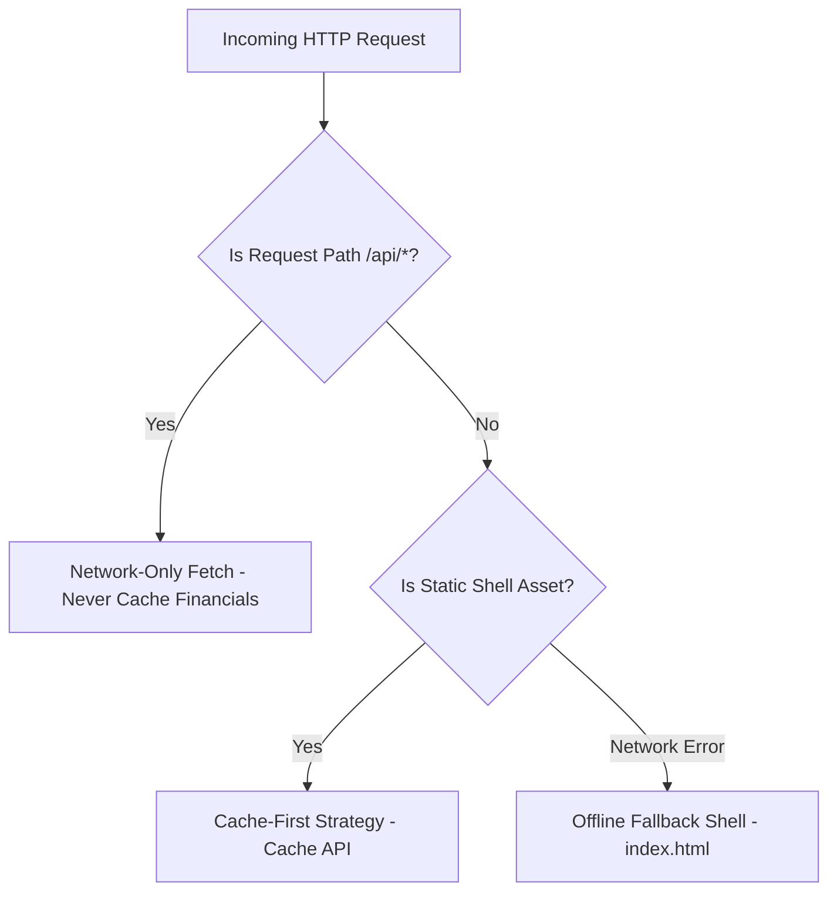

# Township One — Resident Experience & Progressive Web App (PWA)

## 1. Resident Portal Experience

The resident frontend is built as a responsive mobile-first Progressive Web App (PWA) optimized for low-latency interactions on standard mobile devices and desktop browsers.

### Key Features
- **2-Tap Payment CTA:** Prominently surfaced on the resident home screen (`DuesCard.tsx`). Residents can view their outstanding balance and launch the payment modal in a single tap.
- **Multi-Flat Switcher:** Residents or owners with multiple properties (e.g., owner of multiple flats) can seamlessly switch active flat context via the header navigation.
- **Trilingual Internationalization:** Complete native interface localization for:
  - English (`en`)
  - Marathi (`mr`) — *टाऊनशिप वन*
  - Hindi (`hi`) — *टाउनशिप वन*
- **Real-Time Running Ledger:** Residents can inspect their running statement of account with line-by-line debits, credits, and post-transaction balances.

---

## 2. PWA Service Worker & Offline Caching Architecture

The service worker (`frontend/public/sw.js`) provides reliable app shell availability across intermittent mobile connectivity:

### Caching Policies
1. **Pre-Cached App Shell:** HTML skeleton, web manifest (`manifest.json`), icons (`192px`, `512px`), and base styling are pre-cached upon service worker installation.
2. **Runtime Asset Caching:** Hashed JavaScript and CSS bundles emitted by Vite (`/assets/*.js`, `/assets/*.css`) are cached dynamically for instant repeated loads.
3. **Strict Network-Only API Guard:** Any request matching `/api/*` bypasses the cache entirely. Private resident data, ledger balances, and payment tokens are **never** persisted in the service worker cache, ensuring strict compliance with data privacy standards.

---

## 3. Web App Manifest & Mobile Installation

The manifest (`frontend/public/manifest.json`) configures standard mobile PWA installation:
- `name`: "Township One — Resident Portal"
- `short_name`: "Township One"
- `start_url`: "/"
- `display`: "standalone"
- `theme_color`: "#1e40af"
- `background_color`: "#f8fafc"
- Multi-density icons for high-DPI Android and iOS screens.
