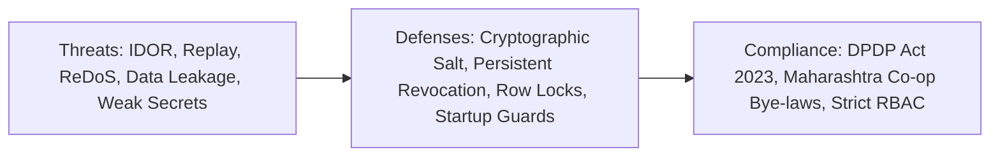

# Township One — Security & Privacy Architecture

## 1. Threat Model & Security Posture

Township One handles resident identity, spatial occupancy, financial accounting, and community security. The application adheres to defense-in-depth principles across all API surfaces.

---

## 2. Security Controls & Implementations

### 2.1 Production Configuration Guards
To prevent insecure deployments:
- **Default Secret Rejection:** The application startup validator (`validate_production_guards()`) aborts with a fatal exception if `APP_ENV=production` and `SECRET_KEY` matches known defaults, placeholders, or contains insufficient entropy (< 32 characters or < 8 distinct characters).
- **Debug Flag Lock:** Production mode requires `DEBUG=False`. Any attempt to run with debug mode enabled is rejected on boot.
- **Simulated Payment Gateway Lock:** In production mode, simulated test checkouts are disabled (HTTP 403 Forbidden).

### 2.2 Broken Object-Level Authorization (IDOR) Defenses
- All requests referencing a `flat_id`, `bill_id`, `payment_id`, or `receipt_number` are validated against the authenticated user's active `flat_memberships`.
- Cross-resident inspection is denied with HTTP 403 Forbidden.
- Error messages never disclose whether an unowned ID exists in the database.

### 2.3 Cross-Resident Idempotency Leakage Prevention
When an idempotency key is submitted:
- The system inspects the stored key's `user_id`.
- If the key was originated by a different user, the system returns a generic HTTP 409 Conflict error.
- **Zero Information Disclosure:** The response does not leak the original payer's name, flat number, bill details, or receipt voucher.

### 2.4 Cryptographic OTP Security
- Raw OTPs are never stored. Challenges store a 16-byte random salt and SHA-256 hash.
- Verification employs `hmac.compare_digest` to prevent timing-based side-channel leaks.
- Production OTPs are generated using `secrets.randbelow(900000) + 100000`. The static demo OTP (`123456`) is accepted **only** in development and testing environments.

### 2.5 Data Protection & DPDP Act 2023 Alignment
- **Visitor Data Retention:** Visitor logs and gate photo metadata are tagged for automated purge after 90 days.
- **Privacy Minimization:** Security guards and gate tablets have zero visibility into resident maintenance ledgers or committee financial reports.
